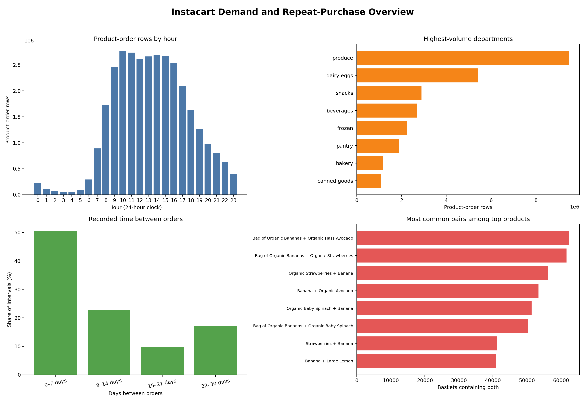
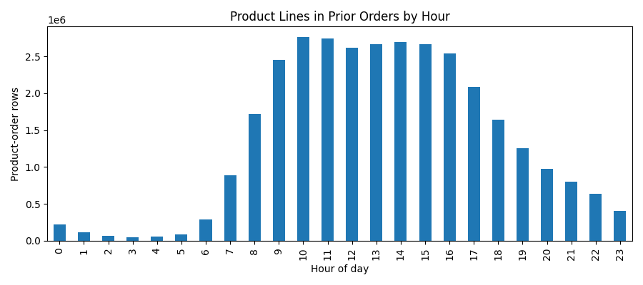
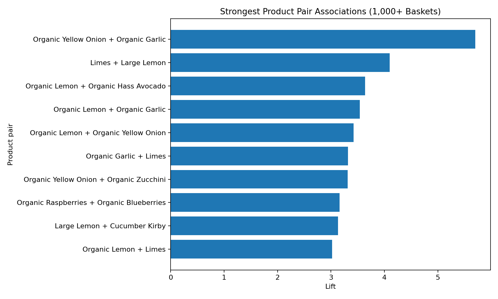

# The Grocery Store That Ran Out First

An Instacart market-basket analysis project that identifies products and categories with high repeat demand and builds a historical replenishment-monitoring shortlist.

## Business question

Which products show both high order volume and strong repeat purchasing, and when is grocery demand busiest?

## Data

The project uses the Instacart Market Basket Analysis dataset [mirror on Kaggle](https://www.kaggle.com/datasets/psparks/instacart-market-basket-analysis). The prior-order file contains 32.4 million product-order rows. The analysis uses `orders.csv`, `order_products__prior.csv`, `products.csv`, `aisles.csv`, and `departments.csv`.

## Approach

- Audited row counts, missing values, duplicate keys, and relationships across the data files.
- Calculated product order volume and reorder rates; created a monitoring shortlist from products in the top quartile for both measures, among products with at least 1,000 order rows.
- Compared demand and reorder rates by aisle and department.
- Examined order timing, basket size, customer order intervals, and co-purchased pairs among the 20 most frequently ordered products.
- Used pair lift to distinguish common pairs from pairs that occur together more often than their separate popularity would suggest.

## Tools

Python, pandas, Jupyter Notebook / Google Colab, and Matplotlib.

## Findings

- 59.0% of the prior product-order rows are marked as reorders.
- Produce is the highest-volume department, with 9.48 million product-order rows.
- Banana is the most frequently ordered product (472,565 rows; 84.4% reorder rate).
- 485 products met the volume-and-repeat thresholds for the historical monitoring shortlist.
- Organic Yellow Onion and Organic Garlic had the strongest pair association among the tested top-product pairs (lift 5.70 across 22,073 baskets).

See [`reports/portfolio_overview.md`](reports/portfolio_overview.md) and [`reports/portfolio_overview.png`](reports/portfolio_overview.png) for the summary. Detailed tables and charts are in `reports/`.

## Visual highlights

### Demand by department and repeat buying

### When customers place orders

### Strongest tested basket associations

## Run the notebook

1. Download the five CSV files listed above from the [Instacart dataset](https://www.kaggle.com/datasets/psparks/instacart-market-basket-analysis) and place them in `data/raw/`.
2. Install the project packages with `pip install -r requirements.txt`.
3. Open [`notebooks/01_.ipynb`](notebooks/01_.ipynb) in Jupyter or Google Colab and run the cells in order.
4. Review the exported summaries and charts in `reports/`.

The notebook reads the source CSV files from `data/raw/`. Raw data is excluded from version control; the reports contain the project outputs.

## Important limitations

The dataset has no inventory counts, stockout events, physical item quantities, product costs, or promotion records. Product-order rows are not units sold. The shortlist indicates historical demand signals to investigate; it does not prove a product ran out or forecast future stockouts. Pair analysis is limited to the 20 most frequently ordered products, and weekday code labels remain unassigned pending source verification.

## Project files

- `notebooks/01_data_audit.ipynb` — guided analysis notebook.
- `reports/` — summary tables, findings, and chart images.
- `data/raw/` — source CSV files used locally; these are excluded from version control.
